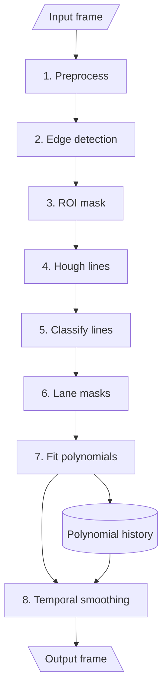

### What is this?

This is a small lane detection system written in C++ with OpenCV. It detects the left and right lane boundaries in driving videos, draws them over the road, and reports how confident it is in each side.

The goal was not to build a complete automotive product, but to make a lightweight and understandable perception pipeline that runs in real time. The output is an annotated video with a heads-up display, together with per-frame detection metrics in a CSV file.

### The pipeline

The input frame first gets converted to HLS, where CLAHE improves the contrast of the lightness channel. Gaussian blur and Canny edge detection then make the road markings easier to isolate. A region-of-interest mask removes most of the image that cannot contain useful lane information.

The remaining edges are processed with a Hough transform. Raycasting provides initial left and right lane candidates, while RANSAC removes outliers before the line segments are grouped. A kernel sweep builds separate masks for both lanes. Their pixels are fitted with quadratic polynomials, which are then smoothed over time using a short history buffer and exponential moving averages.

The final overlay shows solid curves when lanes are detected and fallback guides when a lane temporarily disappears. Confidence decreases gradually instead of resetting immediately, so brief occlusions do not make the output jump around.

### Results

The pipeline usually runs at around 25 FPS on ordinary CPU hardware. It behaves best on clear roads, but I also tested it under several less friendly conditions.

#### Basic

Clear weather, straight road, and dashed markings. Small jumps caused by occasional line misclassification are mostly removed by temporal smoothing.

#### Night

Higher speed, motion blur, and strong contrast from the lights. The detector remains stable, although the lane curves become more shaky.

#### City

Cars, fences, and extra road markings create many structured edges. The middle road marking can sometimes be classified as part of a lane.

#### Rain

Curves, raindrops, and reflections make the road much harder to interpret. This is where the current lightweight approach shows its limits most clearly.

### Limitations

The custom raycasting-based classification keeps the implementation fast and interpretable, but it is not equally reliable in every scene. Rain, glare, dense urban edges, and markings near the middle of the road can produce incorrect lane assignments. More robust outlier rejection and scenario-specific parameter tuning would improve those cases.

For the source code and more details, visit the [LKA repository](https://github.com/loloman333/lka_elte).
