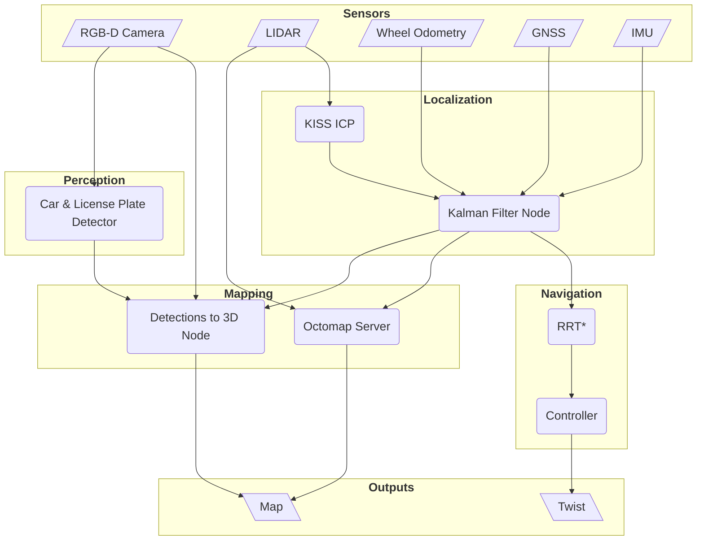

## Autonomous Parking Surveillance Rover

As part of a hands-on university project at ELTE University, I developed an autonomous parking surveillance application for **Pomona**, an AgileX Scout 2.0 rover together with a team of three other students. The system combines localization, navigation, perception, and mapping into a complete robotics stack deployed on a physical platform.

The rover builds an occupancy map of its environment and detects vehicles and license plates with its onboard RGB-D camera. Detected license plates are localized and visualized alongside the environment map.

### Hardware

The robotic platform we used is the [AgileX Scout 2.0](https://global.agilex.ai/products/scout-2-0), a versatile mobile base designed for research and development. It features a differential drive system more than capable of navigating outdoor parking lots. The rover is equipped with a Velodyne LiDAR, an Intel RealSense RGB-D camera, and an Xsens IMU and GNSS module. The onboard NVIDIA Jetson Xavier provides the necessary computational power for real-time processing of sensor data.

### System Architecture

### Localization

An Extended Kalman Filter fuses wheel odometry, IMU data, GNSS, and LiDAR odometry from [KISS-ICP](https://github.com/PRBonn/kiss-icp). Combining these complementary sources provides a more stable pose estimate, particularly when wheel slip affects the mobile base.

### Navigation and Mapping

The navigation stack uses [OctoMap](https://octomap.github.io/) to represent obstacles and a custom Python implementation of RRT* to plan collision-free paths. A controller converts the planned trajectory into movement commands, while dynamic obstacle avoidance supports operation in changing environments. The resulting occupancy map is displayed with estimated positions of license plates, providing a spatial overview of the parking area.

### Perception

Two YOLO-based detection models identify cars and license plates in the camera feed. Optical character recognition extracts the plate text, and the RGB-D data is combined with the robot pose to estimate the 3D position of each detection. An annotated camera stream is published for visualization.

### Outcome

For the source code and project details, visit the [SLAM Parking Inspector repository](https://github.com/IFRoS-ELTE/SLAM-Parking-Inspector).

#### Indoor Localization and Mapping Example

<video controls preload="metadata" width="100%" aria-label="Indoor localization and mapping example">
	<source src="https://github.com/user-attachments/assets/69867808-bfc9-4239-9bcc-c04625a69da3" type="video/mp4">
	<a href="https://github.com/user-attachments/assets/69867808-bfc9-4239-9bcc-c04625a69da3">Watch the indoor localization and mapping example</a>
</video>

#### Indoor Proof of Concept

<video controls preload="metadata" width="100%" aria-label="Indoor proof of concept">
	<source src="https://github.com/user-attachments/assets/1ff0dcbd-c577-468c-bcb8-9eb47d56e458" type="video/mp4">
	<a href="https://github.com/user-attachments/assets/1ff0dcbd-c577-468c-bcb8-9eb47d56e458">Watch the indoor proof of concept</a>
</video>

#### Outdoor Proof of Concept

<video controls preload="metadata" width="100%" aria-label="Outdoor proof of concept">
	<source src="https://github.com/user-attachments/assets/63a21693-b7b1-49f3-9203-98710663427b" type="video/mp4">
	<a href="https://github.com/user-attachments/assets/63a21693-b7b1-49f3-9203-98710663427b">Watch the outdoor proof of concept</a>
</video>