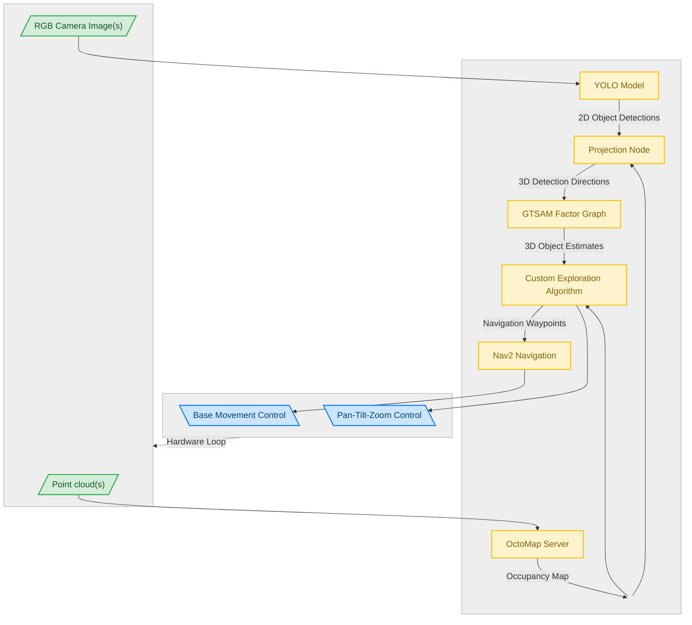

## Active Visual Search System for Boston Dynamics Spot

This project was developed as part of my [Master's Thesis](/assets/documents/thesis.pdf) at [HUNREN Sztaki](https://www.sztaki.hu/en/). It develops an autonomous visual search system for a Pan-Tilt-Zoom (PTZ) camera mounted on the [Boston Dynamics Spot](https://www.bostondynamics.com/products/spot). Instead of relying only on a fixed camera view, Spot actively explores its environment while controlling the camera to search for and observe landmarks.

The system is built as a modular ROS 2 stack. It supports both a Gazebo simulation and deployment on the physical robot, allowing exploration behaviors and perception algorithms to be tested before transfer to Spot.

### About PTZ Cameras

Traditionally, mobile robots carry fixed-viewpoint cameras. If a large field of view is required, multiple cameras are often used. This is no different for the Boston Dynamics Spot robot, which features a total of five fixed RGB-D cameras to cover its surroundings. However, these cameras are not designed for high-resolution inspection of objects but rather for navigation and obstacle avoidance in the robot's immediate vicinity.

With a Pan-Tilt-Zoom camera like the Boston Dynamics Cam+ IR inspection camera, the robot can actively control the camera's orientation and zoom level to inspect objects of interest. This allows for more flexible and efficient visual search strategies. It does introduce additional control complexity, though, as the robot must now coordinate its own motion with the camera's orientation to maximize the effectiveness of its search. This is where this project comes in, providing a complete pipeline for active visual search.

### System Architecture

<bf>Toggle Architecture Diagram</bf>

The system is a full stack of perception, mapping, navigation, and active camera control. The PTZ camera provides high-resolution images for object detection, while the robot's sensors (LIDAR, IMU, wheel odometry) provide localization and mapping capabilities. The exploration algorithm coordinates the robot's movement and camera orientation to maximize the efficiency of the visual search.

### Perception
The perception pipeline uses a YOLO model to produce 2D object detections from the PTZ camera stream. OctoMap ray-casting projects these detections into 3D using the robot pose and environment map.

|  |  |

### Optimization
Landmark measurements are then associated and tracked in a [GTSAM iSAM2](https://gtsam.org/) factor graph, which incrementally optimizes landmark estimates as new observations arrive.

### Navigation
Navigation is handled by [Nav2](https://navigation.ros.org/), which receives waypoints from the exploration algorithm and generates movement commands for the robot base. The occupancy map from OctoMap is used for collision avoidance. Using Nav2 allows the system to be easily adapted to different robotic platforms, as it provides a standard interface for navigation.

### Exploration and Active Camera Control
The exploration algorithm coordinates the robot's movement and camera orientation to maximize the efficiency of the visual search. It uses frontier-based exploration at its core to control the robot's base movement, while a custom PTZ control algorithm determines the optimal camera orientation and zoom level to observe landmarks of interest.

As part of the thesis, I compared different PTZ control strategies. If you are curious about the details, you can read the full thesis [here](/assets/documents/thesis.pdf).

### Modular ROS 2 Packages
For better code organization, maintainability, and adaptability to different robotic platforms, the implementation is split into three ROS 2 packages:

- `ptz_exploration_core` contains perception, PTZ control, exploration behavior, landmark management, and factor-graph optimization.
- `ptz_exploration_sim` provides Gazebo worlds, robot models, and launch files for simulation experiments.
- `ptz_exploration_spot` contains Spot-specific drivers, interfaces, configuration, and Nav2 integration for hardware deployment.

The complete environment runs in Docker, keeping dependencies and runtime configuration consistent across development machines, simulation, and robot hardware. This architecture ensures that platform-specific interfaces are separate from the exploration logic, making it possible to develop and test the visual search system with different robots or camera setups.

### Simulation Environment
The Gazebo simulation environment is designed to replicate the physical robot and its surroundings. It uses a generic robot model with a PTZ camera, showcasing the modularity and versatility of the system. 

### Outcome
For source code documentation and project details, visit the [SPOT PTZ Exploration repository](https://github.com/loloman333/SPOT-PTZ-Exploration).
If you are interested in the full details of the project, you can also read my [Master's Thesis](/assets/documents/thesis.pdf) on the topic.

<video controls preload="metadata" width="100%" aria-label="Active visual search demo on Boston Dynamics Spot">
  <source src="/assets/projects/spotty/demo.mp4" type="video/mp4">
  <a href="/assets/projects/spotty/demo.mp4">Watch the project demo</a>
</video>
